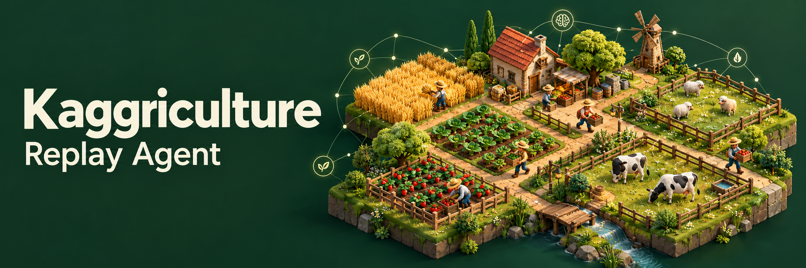

# Kaggriculture Replay Agent

English | [简体中文](README.zh-CN.md)

A PyTorch agent for Kaggriculture that learns worker commands and market decisions from game replays using behavior cloning. The repository includes a pretrained 22.4-million-parameter model, CPU inference, replay preprocessing, and single-device or distributed training.

The policy combines a convolutional board encoder, recurrent memory for each day, attention between workers, and an autoregressive market decoder. It predicts the full action rather than selecting from a library of farming strategies.

## Installation

Requires Python 3.11 or newer. Run the commands below from the repository root, preferably inside a virtual environment:

```sh
python -m pip install -e .
```

Inference runs on CPU. CUDA training requires a PyTorch build with CUDA support and a GPU supporting bfloat16. Distributed GPU training targets Linux with NCCL.

To run local games, install the official environment:

```sh
python -m pip install -e ".[environment]"
```

The supported rules are those of `kaggle-environments==1.32.7`: a 10 by 10 board, 720-state episode and 24-turn day. The policy supports up to 32 actors and ten market orders per decision.

## Run the pretrained model

The checkpoint is at `weights/model.pt`. This example runs a complete game between two independent instances:

```python
from kaggle_environments import make
from farm_policy.agent import Agent

env = make("kaggriculture", debug=True)
env.run([Agent("weights/model.pt"), Agent("weights/model.pt")])
print([player.reward for player in env.state])
```

In another game runner, call `agent(observation, configuration)` to get the action dictionary. Keep one `Agent` instance per player per game and supply observations in chronological order. The wrapper maintains action history, resets recurrent memory at day boundaries and handles repeated calls without advancing memory twice.

The default policy uses the fixed style label `default`. A style is a learned condition on this agent's own behavior, not an opponent identifier. Final-turn inventory liquidation is enabled by default and preserves the network's worker commands.

## Build a submission archive

```sh
python -m tools.package --weights weights/model.pt --output submission.tar.gz
```

The archive contains the entry point, inference modules and checkpoint. Training tools and documentation are excluded.

To package a trained checkpoint, pass its `step-XXXXXX.pt` file to `--weights`. Choose an output path that does not already exist.

## Model

| Component | Configuration |
| --- | --- |
| Board encoder | 52 input channels, 192 hidden channels, three residual blocks |
| Shared and worker representations | 768 dimensions |
| Daily memory | 256-dimensional shared and per-worker GRUs |
| Worker coordination | Two attention layers with four heads |
| Worker actions | 44 command tokens with conditional quantity prediction |
| Market actions | Up to ten sequential orders from a 23-token vocabulary |

Features include public board and market state, the agent's private inventory, previous actions and observed market changes. Future replay states are used only for training labels. Local action masks and a sequential shared-seed quota constrain worker predictions.

Training combines action imitation with auxiliary targets for near-term worker intent and remaining score margin. Random erasure of previous-action inputs reduces reliance on perfect demonstration history.

## Prepare replay data

Supply completed official replays as `.json` or `.json.gz` files. Replay data is not included in this repository.

Create `data/replays.json` with one entry per game. Paths are relative to the manifest. The filenames below are examples to replace with your own:

```json
{
  "episodes": [
    {
      "id": "game_001",
      "file": "replays/game_001.json.gz",
      "players": {"0": "default"},
      "group": "new"
    },
    {
      "id": "game_002",
      "file": "replays/game_002.json",
      "players": {"1": "default"},
      "group": "rehearsal"
    }
  ]
}
```

`players` selects which seats to imitate and their training style labels. Use `default` for demonstrations intended to fine-tune the default policy, or consistent labels of your own to train separate styles. Both seats can appear in the same entry. Optional `group` defaults to `new`; use `rehearsal` for older demonstrations to mix into continuation training.

```sh
python -m tools.data prepare --manifest data/replays.json --output data/encoded --workers 4
python -m tools.data cache --source data/encoded --output data/cache
```

Preprocessing aligns each observation with its following action and writes compressed per-seat arrays. Game IDs determine an approximately 80/10/10 train/validation/test split. Both seats stay together. Keep IDs stable, never list the same game under different IDs, and provide enough games to populate the training and validation partitions.

The cache contains read-only memory-mapped training and validation arrays. Test games remain outside it. Allow extra disk space for these uncompressed arrays; both preparation commands require empty output directories.

## Fine-tune and train

Fine-tune the pretrained policy on the prepared data:

```sh
python -m tools.train --cache data/cache --output runs/finetune --warmstart weights/model.pt --style default --batch-days 8 --steps 12000
```

Style labels in the manifest determine which conditions receive training. `--style` selects the default condition saved for deployment; it does not relabel or filter the data. An existing style reuses its embedding. A new label adds a randomly initialized embedding while retaining the shared pretrained network. Training updates the network; existing styles are not frozen.

To train from scratch, omit `--warmstart`:

```sh
python -m tools.train --cache data/cache --output runs/scratch --style default --batch-days 8 --steps 12000
```

For four CUDA workers on Linux:

```sh
torchrun --standalone --nproc_per_node=4 -m tools.train --cache data/cache --output runs/distributed --warmstart weights/model.pt --style default --batch-days 32 --steps 12000
```

`--batch-days` is the global batch across all workers, not the batch per GPU. It must be divisible by the worker count. Each day is a 24-frame sequence. Reduce the batch size if device memory is insufficient.

The default recipe uses AdamW with weight decay `1e-4`, gradient norm clipping at 1, and 15% history erasure. Learning rate defaults to `1e-4` from scratch or `1e-5` with a warm start. When both data groups exist, 70% of samples come from new demonstrations and 30% from rehearsal. New styles are sampled uniformly before selecting a trajectory and day. These settings are starting points and can be changed with the command-line options.

Checkpoint intervals produce deployable `step-XXXXXX.pt` files and a `training.pt` containing the latest optimizer and random states. Resume with the same data, batch size, worker count and sampling settings:

```sh
python -m tools.train --cache data/cache --output runs/finetune --resume runs/finetune/training.pt --style default --batch-days 8 --steps 16000
```

`--steps` is the total update count, including completed updates. Use the same `torchrun` launch when resuming a distributed run. A file named `STOP` inside the run directory requests a checkpoint and exit after the next update; remove it before resuming. `--device cpu` supports small debugging runs.

Validation loss and action accuracy measure replay prediction, not game strength. Evaluate frozen checkpoints in complete games with both seats and held-out worlds. The code provides a reusable training recipe; reproducing the exact supplied checkpoint also requires its original demonstration corpus and optimization trajectory.

## Repository layout

| Path | Purpose |
| --- | --- |
| `main.py` | Kaggle entry point |
| `farm_policy/` | Model, feature encoding, stateful inference and terminal liquidation |
| `tools/data.py` | Replay preparation, splits and sequence batches |
| `tools/train.py` | Behavior cloning and distributed training |
| `tools/package.py` | Submission archive builder |
| `weights/model.pt` | Pretrained checkpoint |
